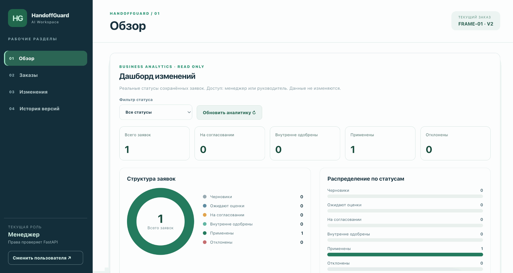
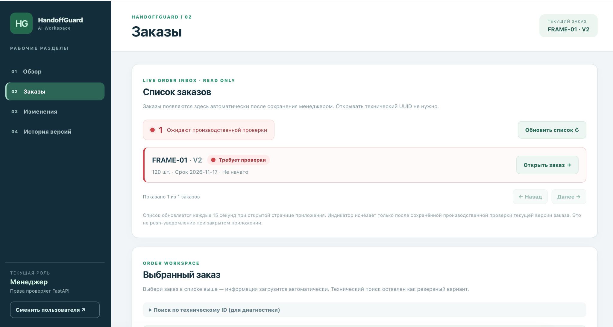
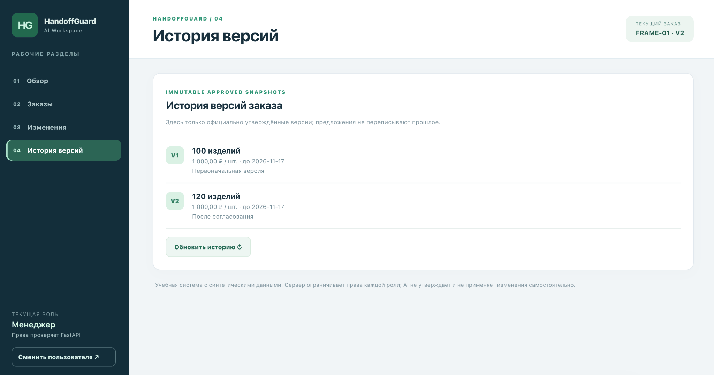
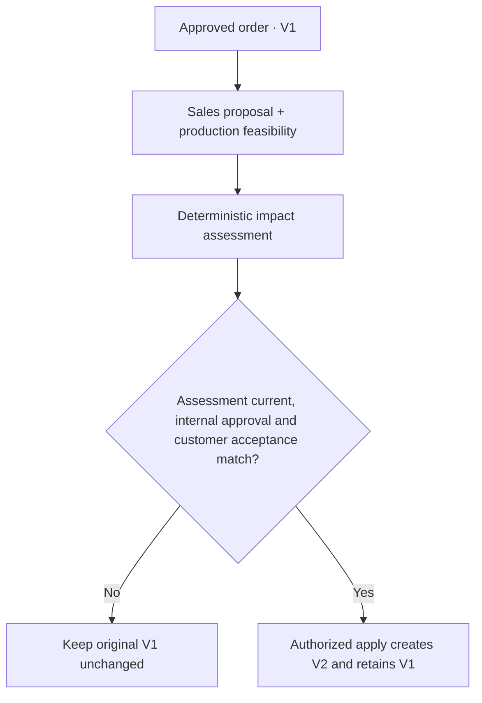

# HandoffGuard AI

**Human-controlled manufacturing order changes — from impact assessment to approved revisions, without overwriting the original agreement.**

**DataTalks.Club AI Dev Tools Zoomcamp 2026 — Project 1**

[**Live educational demo**](https://handoffguard-ai-demo.onrender.com) · [**Verified release v0.3.0**](https://github.com/butomaya12-wq/handoffguard-ai/releases/tag/v0.3.0) · [**Submission evidence**](https://github.com/butomaya12-wq/handoffguard-ai/issues/6) · [**Product specification**](product-spec.md)

> **Reviewer access is required.** The protected hosted demo uses a reviewer login and separate cloud-only synthetic business-role credentials. Request them privately from the owner. **Never** post credentials or customer information in issues or screenshots. Render Free may need to wake up.

## Product walkthrough — verified hosted screenshots

Actual owner-captured browser screens from the protected Render app, **22 October 2026**. The sample order `FRAME-01` and all numbers are **synthetic**, not client data. This is a manual UI walkthrough, not automated browser E2E evidence.

### 01 · Manager dashboard

One applied change in the persistent dataset, shown consistently in the KPI cards, status chart and read-only summary. Counts are not illustrative placeholders.



### 02 · Order inbox — current approved order

`FRAME-01 · V2`: 120 units, due 2026-11-17. The **Requires production review** badge flags the current revision for a new production check; it does not mean the approved change failed. The order can be opened directly from the list, with no UUID lookup.

[](docs/images/handoffguard-order-inbox.png)

### 03 · Immutable approved revision history

**V1 = 100 units** and **V2 = 120 units**, both at 1,000 RUB per unit, due 2026-11-17. The authorized V2 update preserves the original approved V1 for auditability.

[](docs/images/handoffguard-version-history.png)

## Workflow at a glance

**Approved V1 → Sales proposal → Production review → Impact assessment → Internal approval → Customer acceptance → Approved V2.**



**Human approval is mandatory.** The AI model does not approve commercial terms, alter order quantities or halt production. Business role permissions and stale-assessment checks are enforced by the FastAPI backend.

**Release evidence:** [v0.3.0](https://github.com/butomaya12-wq/handoffguard-ai/releases/tag/v0.3.0) pins `a2d9a9b1d709236689e59f6c8cdab5ecb8583b00`: six main-branch CI checks passed, Render confirmed live and read-only Neon verification preserved both revisions and their approval/acceptance chain. The functional workspace was manually verified in the browser after [PR #33](https://github.com/butomaya12-wq/handoffguard-ai/pull/33); see [post-release evidence](https://github.com/butomaya12-wq/handoffguard-ai/issues/6#issuecomment-6338169498).

**Local-only engineering experiments:** optional OpenTelemetry/Prometheus/Jaeger monitoring and a bounded, session-preauthorized single-incident AI-assisted on-call recovery are available in a **separate synthetic localhost Compose lab**. They are not running on Render or as unattended cloud recovery. This is **not a production-ready service**.

---

## 1. Problem and outcome

An approved manufacturing order can receive a new customer request for quantity, price or delivery changes after production planning has begun. Treating a message or sales proposal as an approved instruction can create unverified commitments and destroy the original agreed terms.

HandoffGuard AI is a **human-controlled change-impact and approval workflow**, not an ERP/CRM replacement or an autonomous production controller:

1. **Sales** creates an original approved order (V1) and later proposes a separate change.
2. **Production** records current progress and feasibility.
3. **Sales** requests a deterministic impact assessment; unknown inputs remain unknown, and stale proposals cannot be approved.
4. A separate, authorized **company approver** approves or rejects the exact assessed proposal.
5. **Sales** records matching customer acceptance of the new terms.
6. Only after both approvals, a permitted apply operation creates **V2** and keeps the V1 history.

**Invariant:** AI-generated text, a customer's request and a pending proposal can never directly rewrite an approved order or stop production. The AI assistant is used to help **develop** the app; it is not an implemented runtime agent that approves business decisions.

## 2. Architecture and scope

```text
Local:   Browser -> Nginx (React/TypeScript) -> FastAPI -> SQLite volume
Hosted:  Browser -> Render HTTPS + reviewer cookie gate
                    -> same-origin React + FastAPI -> Neon PostgreSQL
                    -> allowlisted business-operation logs (Render Logs)
                    -> bounded Telegram notifier for repeated business HTTP 5xx
```

- **Frontend:** React, TypeScript, Vite, typed API calls and explicit review/approval stages. See [frontend/README.md](frontend/README.md).
- **Backend:** FastAPI, Pydantic, SQLAlchemy, server-side role gates, fingerprint-bound approvals and conditional revision updates. Money is represented in integer kopeks; missing cost data never becomes zero. See [backend/README.md](backend/README.md).
- **Persistence:** local Docker Compose uses a named SQLite volume; the hosted demo uses managed Neon PostgreSQL. Order history, approvals and customer acceptance survive releases.
- **Security boundary:** hosted demo has a private reviewer session gate plus three server-validated business-role bearer tokens. It is an **educational shared demo**: no production identity provider, tenant isolation, legal e-signature or real-customer integration.
- **Observability:** structured, redacted, correlated workflow/request UUIDv4 logs and per-event `business_operation_total=1` measurements in Render Logs. These are log-derived signals, **not a persistent metrics database**.
- **Hosted role-based business workspace (released via [PR #33](https://github.com/butomaya12-wq/handoffguard-ai/pull/33)):** React sidebar and server-validated role login, read-only dashboard with real status distribution, authenticated order inbox and revision-specific review queue. The owner verified these in the live Render browser on 2026-10-22, including manager login and FRAME-01 V1/V2 navigation. Sales/production/approver permissions still rely on backend checks; UI hiding alone is not access control. See [dashboard design and historical review record](docs/dashboard-issue20.md).
- **Optional *local* Observability v2 lab (code in `main`; **NOT** running on Render):** OpenTelemetry request spans and log `otel_trace_id`, Prometheus counter/latency histogram with trace exemplars, and Jaeger UI in a separate Compose project. Local endpoints: app `http://127.0.0.1:8082`, Prometheus `http://127.0.0.1:9090`, Jaeger `http://127.0.0.1:16686`. Separate synthetic SQLite and telemetry volumes; reviewers must run the lab themselves to view its UIs. See the [local lab runbook](docs/observability-v2-lab.md) and [Issue #29](https://github.com/butomaya12-wq/handoffguard-ai/issues/29).
- **Alerting:** a best-effort Telegram notifier for **three HTTP 5xx from the same `createOrder` or `applyApprovedChange` operation within five minutes**, with a 15-minute per-operation cooldown. Controlled 401/403/409/422 outcomes are not outages. In-process counters reset when Render Free restarts/sleeps. The actual backend-to-Telegram diagnostic delivered successfully; **no real incident was simulated on the hosted system**.
- **Local-only one-shot On-call Agent (code merged via [PR #33](https://github.com/butomaya12-wq/handoffguard-ai/pull/33); **NOT** running on Render):** two distinct Prometheus `up=0` scrapes trigger at most one opt-in OpenAI `gpt-5.4-mini` structured diagnosis. Experimental `--auto-recover` requires **two separate explicit authorizations at startup**; only a fixed `docker compose start backend` is permitted after independent checks of local-only context, stopped container and fresh scrapes. Docker health and two distinct fresh `up=1` scrapes must confirm recovery. No arbitrary Docker tool access or customer data goes to the model. The owner demonstrated one intentionally stopped synthetic lab backend on 2026-10-22, with unchanged local FRAME-01 V1/V2 history. This is **not** unattended 24/7 incident response. See [runbook](docs/oncall-ai-triage.md), [UAT](docs/oncall-autorecover-owner-uat-2026-10-22.md) and [Issue #28](https://github.com/butomaya12-wq/handoffguard-ai/issues/28).
- **Not implemented:** autonomous control of business orders, scanned-message extraction, full source-ingestion API, production SSO, multi-tenant controls, automated browser E2E, cloud on-call remediation or a continuously hosted monitoring agent. The [OpenAPI draft](openapi.yaml) includes a **planned** source-ingestion route that is not present in the running application.

## 3. Run locally with one command

**Prerequisites:** Docker Engine/Desktop with the Compose plugin. Provide only synthetic local business-role tokens (never reuse the private hosted credentials).

Create an ignored `.env` in the repository root. Example values for **local development only**:

```dotenv
HANDOFFGUARD_AUTH_TOKENS={"local-sales-only":{"id":"sales-demo","role":"sales"},"local-production-only":{"id":"production-demo","role":"production"},"local-approver-only":{"id":"approver-demo","role":"approver"}}
```

Then from the repository root:

```sh
docker compose up --build -d
```

Open **http://127.0.0.1:8080**. The local Compose app uses a named SQLite volume `gate04_data`. Verify services with `docker compose ps`; stop with `docker compose down`. **Do not** add `-v` to `down` if you want to keep the local database.

For separate FastAPI / Vite development, see [backend setup](backend/README.md) and [frontend setup](frontend/README.md). The local synthetic tokens above are explicitly **unsuitable for public deployment**.

### Optional local observability and one-shot on-call experiment (not hosted)

With Docker Desktop running and a **locally ignored** `.env` containing *synthetic-only* role tokens, start the independent lab without touching normal Compose or the hosted service:

```bash
docker compose -f docker-compose.observability.yml up --build -d --wait
```

The lab app is available on `http://127.0.0.1:8082`; Prometheus is on `http://127.0.0.1:9090`; Jaeger is on `http://127.0.0.1:16686`. It uses independent named SQLite, metric and trace volumes and localhost bindings. Review [lab startup, metrics and traces](docs/observability-v2-lab.md). No live cloud credentials are required.

On-call safety tests require **no** OpenAI API key and make no billed calls:

```bash
python3 -m unittest discover -s oncall/tests -v
python3 -m oncall.agent --demo
```

The second command is a **fixed offline example** and must not be presented as an actual LLM inference. A real opt-in analysis, let alone `--auto-recover`, requires a privately configured API key, separate interactive owner consent and a deliberately isolated test-only outage. **Do not intentionally stop a backend while demonstrating the hosted application, and do not use production records or secrets.** See the [on-call runbook](docs/oncall-ai-triage.md) and [owner UAT record](docs/oncall-autorecover-owner-uat-2026-10-22.md). Never use `docker compose down -v` on a lab whose test history you want to preserve.

## 4. Tests and CI — reproducible instructions

**Prerequisites for host-based tests:** Bash, Python 3.11+ with venv/pip, Node.js 22/npm. From a fresh checkout, install dependencies once:

```sh
python3 -m venv backend/.venv
backend/.venv/bin/python -m pip install -e ./backend 'pytest>=8,<10' httpx pyyaml
(cd frontend && npm ci)
```

Run the complete local test/build suite:

```sh
bash scripts/test-all.sh
```

The script fails fast on backend pytest, frontend Vitest or TypeScript/Vite build failures. It does not touch the hosted Neon database. **Owner Mac verification on the combined feature branch (2026-10-22):** `bash scripts/test-all.sh` passed **56 backend pytest tests**, **17 frontend Vitest tests**, and the TypeScript/Vite production build. The separate offline `python3 -m unittest discover -s oncall/tests -v` passed **51 tests**. Backend pytest emitted one non-failing Starlette/httpx deprecation warning. **Release evidence:** all seven PR-head CI workflows passed before merging [PR #33](https://github.com/butomaya12-wq/handoffguard-ai/pull/33), and six push-to-`main` checks passed on the [released commit](https://github.com/butomaya12-wq/handoffguard-ai/commit/188957513dbe2678a348a86a9a2492ce0e55340a). A working-tree Mac run is **not** a fresh clean-checkout proof; verify a new commit's CI separately. Optional real OpenTelemetry in-memory tests require `backend/.venv/bin/python -m pip install -e './backend[observability]'`.

Seven GitHub Actions workflow definitions exist in the merged repository: [backend](.github/workflows/backend-ci.yml), [frontend](.github/workflows/frontend-ci.yml), [full stack](.github/workflows/full-stack-ci.yml), [Docker Compose smoke](.github/workflows/docker-ci.yml), [isolated PostgreSQL integration](.github/workflows/postgres-ci.yml), [local observability lab](.github/workflows/observability-lab-ci.yml), and [on-call safety and AI-adapter tests](.github/workflows/oncall-readonly-ci.yml). The seven PR-head checks and six `main` push checks above refer to different trigger sets; they are not contradictory. CI-gated updates to `main` **automatically deploy** to Render, so the owner must explicitly approve every future merge. See [deployment and rollback evidence](https://github.com/butomaya12-wq/handoffguard-ai/issues/11). CI does not call paid OpenAI APIs or run production Docker remediation.

## 5. Reviewer walkthrough

1. Open the [live demo](https://handoffguard-ai-demo.onrender.com); authenticate with the privately supplied **reviewer key**.
2. Use the separately supplied **sales**, **production** and **approver** demo-role credentials as prompted in the business UI.
3. Create a synthetic **V1, quantity 100**, record a production feasibility review, propose **120**, assess impact and submit for approval.
4. As approver, approve the exact current assessment; as sales, record matching customer acceptance; apply with the authorized role to obtain **V2, quantity 120**.
5. Verify that both revisions are visible and an invalid/stale or unauthorized operation is blocked. **Use only new synthetic test data**; do not alter the protected historical V1/V2 order in the owner's hosted database without approval.

The owner verified the end-to-end hosted synthetic V1=100 → approved/accepted V2=120 workflow before this release and confirmed persistence through repeated Render releases with read-only Neon SQL. **Post-release on 2026-10-22**, the owner authenticated with the reviewer perimeter and cloud-only manager role, saw real noninvented dashboard counts (**1 applied change**), opened `FRAME-01 · V2` from the new order inbox without a UUID, and viewed the unchanged V1=100 and V2=120 history (both 1,000 RUB/unit, due 2026-11-17). The `Requires production review` indicator for V2 is expected. [Browser UAT evidence](https://github.com/butomaya12-wq/handoffguard-ai/issues/6#issuecomment-6338169498). This was **manual** browser verification, not automated Playwright/Cypress E2E. Do not overwrite the protected hosted sample.

## 6. Public task and AI-assisted development evidence

The work is human-led and AI-assisted. **One assistant performed planning, code, testing analysis and security review functions sequentially**; these are roles, not separately deployed independent agents. Human approval was required before merging and deploying.

- [Public project acceptance tracker #6](https://github.com/butomaya12-wq/handoffguard-ai/issues/6), with criteria, acceptance and evidence.
- [Agent collaboration specification](docs/agent-team-and-handoffs.md) and scoped [Issue #7](https://github.com/butomaya12-wq/handoffguard-ai/issues/7) / merged [PR #8](https://github.com/butomaya12-wq/handoffguard-ai/pull/8).
- [Testing Issue #9](https://github.com/butomaya12-wq/handoffguard-ai/issues/9), merged [PR #10](https://github.com/butomaya12-wq/handoffguard-ai/pull/10).
- [Deployment/rollback Issue #11](https://github.com/butomaya12-wq/handoffguard-ai/issues/11), including actual Render/Neon verification.
- [Observability Issue #16](https://github.com/butomaya12-wq/handoffguard-ai/issues/16) and merged [PR #17](https://github.com/butomaya12-wq/handoffguard-ai/pull/17).
- [Alerting Issue #18](https://github.com/butomaya12-wq/handoffguard-ai/issues/18), [diagnostic Issue #22](https://github.com/butomaya12-wq/handoffguard-ai/issues/22), merged [PR #19](https://github.com/butomaya12-wq/handoffguard-ai/pull/19), [PR #24](https://github.com/butomaya12-wq/handoffguard-ai/pull/24). Owner-confirmed real diagnostic delivery from Render to Telegram, after which the temporary trigger was switched off.
- [Documentation audit Issue #25](https://github.com/butomaya12-wq/handoffguard-ai/issues/25), consolidated [release PR #33](https://github.com/butomaya12-wq/handoffguard-ai/pull/33), and [post-release documentation task #34](https://github.com/butomaya12-wq/handoffguard-ai/issues/34). [Architecture decisions](docs/decision-record.md), [golden synthetic cases](fixtures/golden-cases.json), [historical AI workflow log](docs/ai-development-workflow.md) and [task-scoped context guide](AGENTS.md).

Historical Gate reports describe evidence **at their original dates**, not the latest release state. Any newer submission release must be checked again.

## 7. Submission status and limits

This is a **course demonstration**, not an incident management, identity, monitoring or factory-control product qualified for production use. Render Free may suspend/restart, Telegram notifications are best effort, and private educational role credentials cannot replace production authentication. The **optional local on-call responder** has one independently observed, bounded, session-preauthorized recovery UAT; it is not part of the hosted Render release, an unattended daemon, a general incident fixer, or a claim of production reliability.

The [official project rubric](https://github.com/DataTalksClub/ai-dev-tools-zoomcamp/blob/main/project/README.md) requires **English documentation** and **three peer reviews** after submitting. The [Project 1 submission page](https://courses.datatalks.club/ai-dev-tools-2026/project/project1) displayed **26 October 2026, 23:00 in the viewer's timezone** when reviewed on 2026-10-22; confirm the actual deadline in the logged-in course account. Submit the public repository with the **exact final `main` commit SHA actually reviewed**, which may differ from the verified 2026-10-22 release SHA if a later documentation PR is merged. The local on-call experiment is genuine but course criterion 12 credit is subject to reviewers; it is not evidence of cloud remediation. See [submission preflight](docs/submission-preflight-2026-10-22.md).
